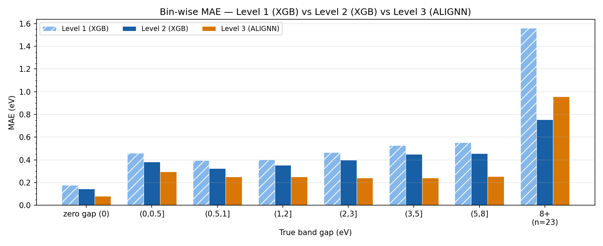

# What Structure Adds to Band-Gap Prediction, and What SHAP Does Not Tell Us

Reproducibility companion to the AI4Mat-NeurIPS 2026 workshop paper (Findings, Tools and Open Challenges track; camera-ready version) and to version 2 of the extended preprint (October 2026), which carries the full supplementary information. An earlier version of the preprint was titled *How Much Structure Does Band-Gap Prediction Need? A Fold-Controlled Representation–Learner Audit from Composition to Graphs on MatBench mp_gap*.

The study compares three models with increasing access to crystal structure on the 106,113-entry MatBench `mp_gap` task, all scored on the official MatBench test folds:

1. **Level 1 — composition:** 132 Magpie `ElementProperty` features with XGBoost;
2. **Level 2 — composition plus engineered structural descriptors:** 283 columns with XGBoost;
3. **Level 3 — atomistic graph:** ALIGNN, whose line graph encodes bond angles explicitly.

> **Version note.** This release (v1.2.0) adds the top-k SHAP deletion test reported in the AI4Mat camera-ready paper; see [Camera-ready addition: top-k SHAP deletion](#camera-ready-addition-top-k-shap-deletion). It needs no new external data, so the data record stays at version v1.1.0 with the same DOI. Release v1.1.0 contained the code and outputs behind preprint version 2. Relative to v1.0.0 it added the deterministic replay of the frozen Level-1 and Level-2 runs with pre-clip (raw) predictions, two further random seeds (101 and 202), the boosting-round cap sensitivity runs, and formula-grouped cross-validation, together with the scripts that summarize them; see [Preprint version 2 robustness analyses](#preprint-version-2-robustness-analyses). With v1.1.0 the external data record moved to version v1.1.0, which adds the frozen Level-1 feature cache. Where this README and the papers differ, the papers take precedence.



## Main findings

Fold means ± population standard deviation across the five official folds (XGBoost limited to 8,000 rounds, seed 42).

| Model | Representation | MAE (eV) | RMSE (eV) | R² |
|---|---|---:|---:|---:|
| Level 1, RF | Composition | 0.3281 ± 0.0032 | 0.5973 ± 0.0065 | 0.8604 ± 0.0026 |
| Level 1, XGB | Composition | 0.3380 ± 0.0050 | 0.5872 ± 0.0084 | 0.8651 ± 0.0030 |
| Level 2, RF | Composition + descriptors | 0.3379 ± 0.0041 | 0.5845 ± 0.0087 | 0.8664 ± 0.0026 |
| Level 2, XGB | Composition + descriptors | 0.2855 ± 0.0030 | 0.4987 ± 0.0075 | 0.9027 ± 0.0021 |
| Level 3, ALIGNN | Atomistic graph | 0.1797 ± 0.0029 | 0.4698 ± 0.0077 | 0.9136 ± 0.0026 |

- **Where structure helps.** Predictions for zero-gap materials collapse onto zero, and for compositions that occur in several structures with very different gaps, ALIGNN falls below the error floor of any composition-only model.
- **Where it does not.** Near the gap boundary, ALIGNN trades errors rather than removing them, placing more gapped materials near zero; in the extreme error tail it is no better than composition alone.
- **What SHAP does not tell us.** Coordination fingerprints receive the largest SHAP share in the descriptor model (26.2%) but can be deleted without loss, whereas deleting global symmetry, with an 11.8% SHAP share, raises MAE by about 10%. Both results hold across three seeds and when XGBoost is trained to convergence.
- **Top-k SHAP deletion.** In every fold the top-ranked structural column is `n_symmetry_ops`, the number of symmetry operations. Deleting it alone raises MAE by +0.028 eV, as much as deleting the whole symmetry group. Deleting the next 19 columns as well, which together carry almost three times its SHAP credit, adds little more (+0.030 eV for the top 20). Random deletions change the error only when they include `n_symmetry_ops`.
- **Robustness of the descriptor gain.** The Level-1-to-Level-2 MAE reduction is 15.6 ± 0.1% across three seeds. It is 12.8% when XGBoost is trained to convergence. Under formula-grouped cross-validation it grows to 17.1%, because random folds let a composition-only model reuse the gaps of same-formula training entries (Section 3.5, SI S14).


## Before running scripts: preserve the frozen release

> **Treat the distributed manuscript outputs as read-only.** Several public scripts retain historical default output directories that are already populated in this release. Some deliberately refuse a non-empty directory; older scripts may overwrite same-named derived files if run in place. Do not delete or repurpose frozen outputs merely to rerun a script.

The protected release artifacts include `results/`, `figure/`, `outputs_v1_run0709/`, `matbench_outputs_v2_run0709/`, `results_v4/`, the angle-mask prediction directory, the historical comparison/training result directories, and the version-2 robustness output directories listed in the [repository map](#repository-map).

Use these rules:

1. If a script exposes `--output-dir`, give it a **new, empty directory** for every run.
2. `compare_l1_bandcenter_l2_l3.py` and `analyze_l1_bandcenter_l2_l3_error_tails.py` always refuse non-empty output directories.
3. `train_l1_plus_bandcenter.py` also refuses a non-empty output directory unless `--resume` is continuing an interrupted run with the same validated run signature. `--resume` is not an overwrite flag and must not be used on the completed release directory.
4. `shap_crossfold_aggregate_audited_v4.py` enforces a fixed output-file contract and rejects directories containing unrelated visible files. A fresh directory is still the recommended route.
5. Scripts and notebooks with a top-of-file `OUT_DIR`, `OUTPUT_DIR`, or similar constant retain their historical locations. Point that constant to a new private working directory, or run the script in a disposable copy of the repository. These historical paths were intentionally not rewritten one by one. This applies in particular to the replay, seed, round-cap and grouped cross-validation notebooks and to `mp_gap_ablation*.py`.
6. Terminal-only verification scripts need no output directory.
7. `train_ids_export.py` records the one-off step used to add one `train_ids.pkl` file for each of the five official folds. It is retained for provenance only and is not required for ordinary reproduction; do not run it against the frozen release directories.
8. `make_group_splits.py` refuses to overwrite an existing `groupcv_splits/` directory; the grouped cross-validation notebooks read that shared split and must not regenerate it.
9. `topk_shap_deletion.py` resumes from an existing `--out-dir`: it skips runs already listed there and rewrites the summary. Give it a new directory, never the released `topk_shap_deletion_structural/`. `mp_gap_v2_export_matrices.ipynb` refuses to overwrite an existing `topk_inputs/l2_matrices.pkl`.

The examples below create a parent run directory but leave each script-specific child directory absent until the corresponding script creates it:

```bash
cd scripts

RUN_TAG=$(date +%Y%m%d_%H%M%S)
REPRO_RUN="../reproduction_runs/${RUN_TAG}"
mkdir -p "$REPRO_RUN"
```

Do not reuse the same `RUN_TAG` after its child directories contain output.

## Reproduction routes

The repository separates numerical verification from feature regeneration and full model training. Most headline downstream analyses can be recomputed without model retraining.

| Route | Inputs | Typical scope | Training required? |
|---|---|---|---:|
| Frozen-output analysis | Distributed predictions, labels, SHAP arrays, compact tables | Main metrics, provenance, boundary/tail analysis, repeated-composition oracle, SHAP aggregation, deletion fold audit, seed and round-cap summaries | No |
| Cache-dependent analysis | `matbench_cache/`, `outputs_v1_run0709/features_cache.pkl`, plus the frozen sources | Featurizer failures, subset robustness, octahedral/TM checks, beeswarm reconstruction, tree replay and descriptor controls | Sometimes |
| Full retraining | Canonical notebooks or Colab scripts, features/exports, complete environments | Level-1/2 models, deletion/BandCenter controls, seeds, round cap, grouped cross-validation, top-k SHAP deletion, ALIGNN and angle mask | Yes |

### Route A: analyses from frozen outputs

Create the portable tree-analysis environment:

```bash
conda env create -f ../environments/tree_analysis.yml
conda activate mp-gap-tree-analysis
```

The fuller `environments/tree_analysis_macos_arm64_lock.yml` records the original macOS arm64 environment; it is archival rather than a portable cross-platform specification.

The following safe sequence uses new output directories. Commands are shown after `cd scripts` and assume the `REPRO_RUN` variable defined above.

```bash
# Four-model alignment and official-fold metrics
python compare_l1_bandcenter_l2_l3.py \
  --output-dir "$REPRO_RUN/four_model_comparison"

# Quantiles, SSE concentration, clipping atom, and directional counts
python analyze_l1_bandcenter_l2_l3_error_tails.py \
  --comparison-results-dir "$REPRO_RUN/four_model_comparison" \
  --output-dir "$REPRO_RUN/error_tails"

# Fold-conditioned repeated-composition oracle and formula-cluster bootstrap
python polymorph_bound_fold_conditioned_v4.py \
  --output-dir "$REPRO_RUN/repeated_composition_oracle"

# Cross-fold SHAP aggregation, deletion summary, and L1-to-L2 transfer
python shap_crossfold_aggregate_audited_v4.py \
  --full-l2-score ../results/frozen_scores/level2/scores_xgb.txt \
  --output-dir "$REPRO_RUN/shap_audit" \
  --fail-on-reference-mismatch
```

The SHAP reference tolerance is an audit tolerance for floating-point accumulation. It does not change the SHAP arrays, aggregation rule, manuscript values, or figures.

The deletion fold verifier is read-only and writes nothing:

```bash
python verify_deletion_per_fold.py
```

It prints official-test MAE for the full Level-2 model and each deletion arm in every fold, followed by equal-weight five-fold summaries with `ddof=0`. The expected mean contrasts are approximately **−0.005315 eV** for coordination deletion and **+0.028701 eV** for symmetry deletion.

Other frozen-output audits, including raw provenance, zero-gap fold stability, binned errors, chemical-family summaries, and R² conventions, are available under `scripts/`. Some retain fixed historical output constants; follow the release-preservation policy above instead of running their defaults against the curated checkout.

### Route B: cache-dependent analyses

`matbench_cache/` is a 1.09 GiB (1,167,993,419-byte), version-sensitive engineered-feature cache rather than an ordinary download cache. It is excluded from the lightweight Git repository and is distinct from `gnn_export/`. The release-associated frozen cache is packaged as its own archive in the version-matched Zenodo dataset record described under [External large-data record](#external-large-data-record). After verification and extraction, its expected repository-relative path is `matbench_cache/`.

The full-run path in `notebooks/mp_gap_baseline_v2_run0709.ipynb` generated this cache by applying eight featurizer families separately to the official outer-training and test structures for each of five folds, producing **5 folds × 2 splits × 8 families = 80** per-family pickle files. Freezing those exact outputs avoids rerunning version-sensitive feature generation and lets cache-dependent analyses consume the same recorded inputs.

The Level-1 notebooks read a separate frozen composition-only cache, `outputs_v1_run0709/features_cache.pkl`, holding the Magpie feature matrices of the official outer-training and test splits for each fold. It is distributed as its own archive from data-record version v1.1.0 onward and restores into the existing `outputs_v1_run0709/` directory.

Cache-dependent tasks include:

- Level-1 + BandCenter training;
- Level-1 and Level-2 deterministic replay, seed and round-cap runs, and deletion retraining;
- formula-grouped cross-validation (both caches);
- top-k SHAP deletion (Level-2 cache);
- featurizer-failure and subset-robustness checks;
- octahedral/transition-metal confounding checks;
- reconstruction of fold-0 SHAP beeswarms.

Frozen predictions and compact outputs are sufficient for the headline numerical audit, so Route A does not require the caches. The tasks listed above do require the version-matched frozen caches; restoring them avoids silent changes from regenerating features with a different software stack.

#### Exact reproduction requires the distributed feature caches

To reproduce the reported numbers exactly, use the two feature caches from the data record rather than regenerating features. The canonical notebooks can recompute features from the structures, but a recomputed cache is not guaranteed to match the frozen one bit for bit:

- **Level-1 Magpie features** are look-ups in elemental property tables and are expected to be stable, but they still depend on the tables shipped with the installed `matminer` release.
- **Level-2 structural features** depend on numerical algorithms and tolerances in `pymatgen`, `spglib` and `scipy`: symmetry detection for `GlobalSymmetryFeatures`, `CrystalNN` neighbour finding for the site fingerprints and `Dimensionality`, and Voronoi tessellation for `StructuralHeterogeneity` and `ChemicalOrdering`. A library upgrade can change these values, or which entries fail to featurize (SI S6), without raising an error.
- **Small changes propagate.** XGBoost uses histogram binning and row and column subsampling, so a small change in one column can change the fitted trees and therefore every prediction. Changed failure sets also change the imputation means.

A run on regenerated features should support the same conclusions, but its values will generally differ in the last digits, and possibly by more. For exact reproduction:

1. Restore `matbench_cache/` and `outputs_v1_run0709/features_cache.pkl` from the data record, and verify them against `LARGE_DATA_SHA256SUMS.txt` and `DATA_FILE_MANIFEST.csv`.
2. Confirm that the files are in place before running a training notebook. The notebooks recompute a missing cache instead of stopping, so a wrong path silently re-runs feature extraction with the installed library versions.
3. Use the recorded environment (`environments/tree_analysis_macos_arm64_lock.yml`).

The deterministic replay reproduced the scored predictions exactly in that environment. On another platform, CPU or thread count, tree training may still differ slightly even with the frozen caches.

After restoring the frozen cache, the BandCenter training control must use a fresh output directory:

```bash
python train_l1_plus_bandcenter.py \
  --cache-dir ../matbench_cache \
  --output-dir "$REPRO_RUN/l1_plus_bandcenter_training"
```

Use `--resume` only to continue that same interrupted directory after its run-signature checks pass.

### Route C: full retraining

The canonical frozen tree-model training records are:

- `notebooks/mp_gap_baseline_v1_run0709.ipynb`;
- `notebooks/mp_gap_baseline_v2_run0709.ipynb`.

Python exports, deterministic replay notebooks and scripts, and the version-2 robustness notebooks are supporting records, not alternative canonical training pipelines. The notebooks in `archive/legacy_diagnostic/` are retained only to explain historical raw-prediction provenance.

The recorded Level-2 notebook run also wrote four core GNN-export files per fold—`train_inputs.pkl`, `train_outputs.pkl`, `test_inputs.pkl`, and `test_ids.pkl`—for 20 files in total. The supplementary `scripts/train_ids_export.py` reads each official outer-training index from MatBench and adds one `train_ids.pkl` per fold, giving the released 25-file `gnn_export/` bundle. Neither step writes test-label files. The supplementary script is intended for the recorded Python 3.9 / MatBench 0.6 environment and writes one `train_ids.pkl` file into each existing fold directory; it does not validate reference sizes or checksums before writing.

`scripts/release/prepare_zenodo_data_release.py` only validates the two frozen v1.0.0 directories, computes manifests and checksums, and packages them deterministically. `scripts/release/prepare_zenodo_data_update_v1_1_0.py` packages the Level-1 feature cache with the same deterministic routine and merges it with the unchanged v1.0.0 record files. Neither script reruns data extraction, featurization, or model training.

ALIGNN training and the explicit-angle control were run in a GPU-enabled Google Colab environment. The entry points are:

- `scripts/colab/v4_alignn_matbench_mp_gap_fixed_final_fi.py` — frozen five-fold ALIGNN pipeline;
- `scripts/colab/v4_alignn_matbench_mp_gap_angle_zero_fold0.py` — configuration-matched fold-0 angle-mask control.

Both entry points require the version-matched `gnn_export/` bundle from the external data record. With the recorded Colab defaults, the project/data root is `/content/drive/MyDrive/matbench_alignn/`; another layout requires changing the top-of-file path constants.

The core Colab stack is installed with:

```bash
bash ../environments/install_alignn_colab.sh
```

The historical transitive Colab dependency set was not completely archived; see `environments/README.md`. Frozen official-test predictions, rather than full retraining, are the primary downstream audit entry point.

## Preprint version 2 robustness analyses

All runs below use the frozen feature caches and the canonical preprocessing (feature means from the complete outer-training fold, internal 80%/20% fit/validation split, early-stopping patience of 200 rounds, clipping to `[0, ∞)` before scoring). Each notebook or script changes only the setting named in its row. Training-information JSON files record, for every fold, the best iteration, the number of rounds run, the round cap, whether early stopping occurred, and the training time.

| Analysis | Entry points | Released outputs | Preprint v2 item |
|---|---|---|---|
| Deterministic replay of the frozen runs, with raw predictions | `notebooks/mp_gap_baseline_v1_run0709_replay.ipynb`, `notebooks/mp_gap_baseline_v2_run0709_replay.ipynb` | `outputs_v1_run0709_replay/`, `matbench_outputs_v2_run0709_replay/` | Section 2.2; Table 2; SI S3 |
| Additional seeds 101 and 202 | `notebooks/mp_gap_baseline_v1_run0709_{101,202}.ipynb`, `notebooks/mp_gap_baseline_v2_run0709_replay_{101,202}.ipynb`, `scripts/mp_gap_ablation_{101,202}.py` | `outputs_v1_seed{101,202}/`, `matbench_outputs_v2_seed{101,202}/`, `matbench_outputs_v2_ablation_{symmetry,coordination}_seed{101,202}/` | Table 1 and Table 5 ("3 seeds"); Section 3.5; SI S14, Table S14a |
| Training to convergence (raised boosting-round cap) | `notebooks/mp_gap_baseline_v1_run0709_50k.ipynb`, `notebooks/mp_gap_baseline_v2_run0709_replay_50k.ipynb`, `scripts/mp_gap_ablation_50000.py` | `outputs_v1_run0709_replay_probe50k/`, `matbench_outputs_v2_run0709_replay_probe50k/`, `matbench_outputs_v2_ablation_{symmetry,coordination}_probe50k/` | Table 1 and Table 5 ("Converged"); Table 6; SI S1; SI S14, Table S14b |
| Formula-grouped cross-validation | `scripts/make_group_splits.py`, `notebooks/mp_gap_v1_groupcv.ipynb`, `notebooks/mp_gap_v2_groupcv.ipynb`, `scripts/summarize_groupcv.py` | `groupcv_splits/`, `outputs_v1_groupcv/`, `matbench_outputs_v2_groupcv/`, `groupcv_results/` | Section 3.5; Table 6; SI S14, Tables S14c and S14d |
| Per-seed, per-fold metrics and paired deletion differences | `scripts/collect_fold_metrics.py` | `results/multiseed/` | Table S14a; Table 5 ("3 seeds") |
| Convergence summary | `scripts/collect_probe100k.py` | `results/round_cap/` | Table S14b; Table 6 |
| Level-2 zero-gap raw statistics and clipping gain | `scripts/L2_raw_MAE.py` | terminal output | Table 2 (Level 2); SI S3 |
| Raw predictions on exact-zero targets | `scripts/neg_and_family_analysis_v5.py` | `figure/metal_raw_hist_v2.png`, `results/neg_and_family_v2/` | Figure S6; Table 2; SI S3 |
| Level-1 versus Level-2 error on feature-complete and featurizer-failure subsets | `scripts/subset_robustness_check_v2.py` | terminal output | SI S6 (subset table) |

**Deterministic replay.** Each replay notebook reruns the frozen notebook unchanged except for a new output directory and an additional save of the pre-clip prediction before clipping. In every fold, the replayed clipped predictions match the scored predictions exactly, and clipping the replayed raw predictions reproduces them exactly. For Level 1, the best iteration and best validation MAE also match the original training records. For Level 2, the replayed SHAP values match the original values exactly. The Level-1 random-forest replay agrees with the frozen predictions to within 4.4 × 10⁻¹⁵ eV. That difference comes from the order in which per-tree predictions are summed across threads, not from a change in the fitted trees.

**Round-cap naming.** Notebooks, scripts and output directories carrying the suffix `_50k`, `_50000` or `_probe50k` belong to the training-to-convergence analysis. The first run (Level 2, fold 0) used a cap of 50,000 boosting rounds. All other runs used a cap of **100,000** rounds, despite the suffix. Early-stopping patience stayed at 200 rounds. Every run stopped by early stopping before reaching its cap (at most 53,721 rounds). The actual cap is recorded as `num_boost_round_max` in each run's training-information JSON. The suffix was kept unchanged so that existing outputs and the scripts that read them remain consistent; the summary script is named `collect_probe100k.py`. The fitted XGBoost model files of these runs (`*.ubj`, 118–210 MB each) are not distributed; their predictions and training-information JSON files are, and the models can be regenerated with the listed notebooks and scripts.

**Formula-grouped cross-validation.** `make_group_splits.py` assigns every entry to one of five outer folds with `GroupKFold(n_splits=5)`, grouping by `pymatgen` reduced formula, and draws one inner fit/validation split per outer fold with `GroupShuffleSplit(test_size=0.2, random_state=42)`, also grouped by reduced formula. Both Level-1 and Level-2 read the same files in `groupcv_splits/` (`folds.csv`, `inner_splits.csv`, `split_meta.json`), which also record the software versions and per-fold group counts. The formula overlap is zero between outer training and test entries and between inner fit and validation entries in every fold. Because `test_size` refers to formula groups, the inner validation share of entries differs from 20% and is recorded per fold. Feature means are computed on the outer training fold, as in the canonical runs, so the grouped and official-fold protocols differ in how entries are split, both outer and inner, and in nothing else. `groupcv_results/` contains per-entry predictions for both protocols, with columns `protocol, config, seed, fold, id, formula, formula_count_global, y_true, y_raw, y_clip`; `formula_count_global` is a descriptive count and is not a model input.

## Camera-ready addition: top-k SHAP deletion

Added for the AI4Mat camera-ready paper in response to review, as a direct test of attribution: rank the structural columns by SHAP, delete the top k, and compare with random deletions.

| Analysis | Entry points | Released outputs | Camera-ready item |
|---|---|---|---|
| Top-k SHAP deletion with random-k controls | `notebooks/mp_gap_v2_export_matrices.ipynb`, `scripts/topk_shap_deletion.py` | `topk_shap_deletion_structural/` | Section 2 (Setup); Table 3; Appendix A; Appendix C, Table 9 |

**Protocol.** For each official fold, `topk_shap_deletion.py` refits the full Level-2 model (seed 42, 8,000-round limit, the canonical inner split and early stopping) and ranks the 150 structural columns by mean |SHAP|. These are all Level-2 columns except the 132 Magpie features and the composition-derived BandCenter. The ranking uses 3,000 training entries sampled exactly as in the main SHAP analysis, so no test information enters it. The script then deletes the top k columns (k = 1, 5, 10, 20) and retrains the identical pipeline. As controls, it deletes k structural columns drawn at random, three draws per k and fold, each from its own fixed random stream. ΔMAE is paired with the full model of the same fold.

**Inputs and exactness.** `mp_gap_v2_export_matrices.ipynb` is a copy of the Level-2 replay notebook that reads the frozen `matbench_cache/`. It saves, for every fold, the exact one-hot-encoded, aligned and imputed matrices that the canonical notebook passes to XGBoost, without training, to `topk_inputs/l2_matrices.pkl`. That file is several hundred megabytes, above the repository's file-size limit, so it is not distributed; it can be regenerated from the data record in a few minutes. Before any deletion, the script checks that the refitted full model reproduces the frozen Level-2 test predictions (`--reference-pattern`). In every fold the maximum absolute difference was 0 (`reference_check_fold*.json`), so the rankings come from the same models as the published SHAP analysis.

**Outputs.** `topk_results.csv` has one row per fit: fold, configuration, k, draw, number of features, best iteration, MAE, RMSE, the SHAP share of the deleted columns, run time and the deleted column names. `topk_summary.csv` holds the paired fold-level summary, including top-minus-random differences. `shap_ranking_fold*.csv` gives the full ranking of all 283 columns for each fold, and `pool_structural.json` lists the structural pool. Per-entry predictions are not saved.

Two points help when comparing these files with the paper:

- **Imputation.** `run_meta.json` records `"impute": "none"`. This does not mean that missing values were left in place. The exported matrices were already imputed with the outer-training-fold means, exactly as in the canonical notebook, so the script does not impute a second time.
- **Random controls.** Four of the 60 random draws included `n_symmetry_ops`: fold 0 with k = 5 and k = 20, fold 1 with k = 5, and fold 3 with k = 1. The camera-ready Table 3 reports these four draws separately from the other 56. The random rows of `topk_summary.csv` average all draws for each k, including those four, so their means differ from the values in Table 3. Both can be recomputed from `topk_results.csv` using the `deleted` column.

Command, after restoring `matbench_cache/` and running the export notebook (use a new output directory):

```bash
cd scripts
python topk_shap_deletion.py --features-cache ../topk_inputs/l2_matrices.pkl \
  --out-dir "$REPRO_RUN/topk_shap_deletion" --k 1 5 10 20 \
  --reference-pattern '../matbench_outputs_v2_run0709/predictions_xgb/pred_fold_{fold}.npy'
```

The full run takes 85 fits of about 1.5 minutes each on the recorded laptop.

## Repository map

| Path | Contents |
|---|---|
| `notebooks/` | Canonical Level-1 and Level-2 frozen training notebooks, the version-2 replay, seed, round-cap and grouped cross-validation notebooks, and the top-k matrix export notebook |
| `archive/legacy_diagnostic/` | Superseded notebooks and scripts retained only for provenance |
| `archive/figure/`, `archive/shap/`, `archive/polymorph/` | Version-1 figures and audit outputs superseded by the regenerated version-2 files |
| `scripts/` | Analysis, audit, replay, control-training, grouped-split, summary, and figure entry points |
| `scripts/colab/` | Frozen ALIGNN and angle-mask Colab training scripts |
| `environments/` | Portable analysis environment, archival platform record, and Colab installer |
| `figure/` | Frozen manuscript and Supporting Information figures |
| `results/` | Curated scores, tables, audit reports, configurations, replay records, seed and round-cap summaries, and training-information records |
| `outputs_v1_run0709/` | Frozen Level-1 predictions, SHAP arrays, feature names, and training metadata; the Level-1 feature cache is restored here from the external record |
| `matbench_outputs_v2_run0709/` | Frozen Level-2 predictions and SHAP artifacts |
| `matbench_outputs_v2_ablation_symmetry/`, `matbench_outputs_v2_ablation_coordination/` | Frozen five-fold deletion predictions, scores, and available training curves |
| `outputs_v1_run0709_replay/`, `matbench_outputs_v2_run0709_replay/` | Deterministic replay predictions, including pre-clip raw predictions |
| `outputs_v1_seed*/`, `matbench_outputs_v2_seed*/`, `matbench_outputs_v2_ablation_*_seed*/` | Seed 101 and 202 predictions, scores, and training-information records |
| `*_probe50k/` | Training-to-convergence predictions and training-information records (caps of 50,000 or 100,000 rounds, see above; model files not distributed) |
| `groupcv_splits/`, `outputs_v1_groupcv/`, `matbench_outputs_v2_groupcv/`, `groupcv_results/` | Shared grouped splits with audit metadata, grouped cross-validation outputs, and per-entry prediction tables for both protocols |
| `topk_shap_deletion_structural/` | Top-k SHAP deletion results: per-run table, summary, per-fold SHAP rankings, reference checks and deletion pools |
| `topk_inputs/` | Exported Level-2 matrices for the top-k test; regenerated locally with `mp_gap_v2_export_matrices.ipynb`; not tracked in Git |
| `results_v4/` | Frozen Level-3 raw and clipped per-fold predictions |
| `result_v4_angle_zero_fold0/` | Fold-0 angle-mask raw and clipped predictions |
| `matbench_outputs/` | Archived Level-1 and older-imputation Level-2 raw arrays used by the provenance audit |
| `gnn_export/` | Externally distributed official-fold train/test structure and identifier export with training labels and no test-label files; place here after extraction; not tracked in Git |
| `matbench_cache/` | Externally distributed frozen engineered-feature cache; place here after extraction; not tracked in Git |
| `MANIFEST.csv` | Release-path, role, size, and checksum metadata; regenerate after the tree is final |
| `SCRIPT_INDEX.csv` | Curated canonical/supporting status and release path; update and validate against the final tree |
| `SHA256SUMS.txt` | File-integrity checksums; regenerate after the tree is final |
| `LARGE_DATA_SHA256SUMS.txt` | Approved archive-level checksums for the three external large-data archives |
| `ARCHIVE_ONLY.txt` | Exploratory or superseded files intentionally excluded from the public analysis surface |
| `DECISION_LEDGER.md` | Sanitized record of consequential analytical, provenance, and reporting decisions underlying the released manuscript |

Historical directory names are retained because they are referenced by frozen audits. They do not define additional model levels.

### External large-data record

Large artifacts are excluded from Git. The release-associated `gnn_export/` bundle, the engineered-feature `matbench_cache/`, and the Level-1 feature cache are packaged as three separately downloadable, versioned archives for one Zenodo **Dataset** record.

| Restored path | Archive file | Extracted contents | Archive bytes | Extracted files / bytes | Required for | Required for frozen-output Route A? |
|---|---|---|---:|---:|---|---:|
| `gnn_export/` | `mp_gap_gnn_export_v1.0.0.tar.gz` | Five official folds of train/test structures and identifiers plus training labels; no test-label files | 382,354,434 | 25 / 2,141,092,523 | Full ALIGNN and angle-mask retraining | No |
| `matbench_cache/` | `mp_gap_matbench_cache_v1.0.0.tar.gz` | Frozen outputs for 5 folds × train/test × 8 featurizer families | 443,839,749 | 80 / 1,167,993,419 | Level-2/BandCenter training and replay, deletion retraining, grouped cross-validation, and cache-dependent SI audits | No |
| `outputs_v1_run0709/features_cache.pkl` | `mp_gap_v1_features_cache_v1.1.0.tar.gz` | Frozen Level-1 Magpie feature matrices for 5 folds × train/test | 94,498,800 | 1 / 560,319,457 | Level-1 training, replay, seed, round-cap and grouped cross-validation runs | No |

Version-specific data DOI (v1.1.0): **[10.5281/zenodo.23482983](https://doi.org/10.5281/zenodo.23482983)**

The previous data version, v1.0.0 ([10.5281/zenodo.22038572](https://doi.org/10.5281/zenodo.22038572)), contains the first two archives only. Version v1.1.0 carries both over byte-for-byte and adds the Level-1 feature cache.

The data record contains exactly seven files: the three archives above, `DATA_README.md`, a data-record-specific `LICENSES_AND_ATTRIBUTION.md`, `DATA_FILE_MANIFEST.csv`, and `LARGE_DATA_SHA256SUMS.txt`. The data-record license file is self-contained for the Zenodo deposit and is distinct in scope from the repository-wide file of the same name.

After downloading, verify each archive against `LARGE_DATA_SHA256SUMS.txt`, then extract all three at repository root so that the restored paths are exactly `gnn_export/`, `matbench_cache/`, and `outputs_v1_run0709/features_cache.pkl`. `DATA_FILE_MANIFEST.csv` records relative path, byte size, and SHA-256 for every extracted member. All bundles contain Python pickle files and should be loaded only from the checksummed project record with the documented environments.

The repository's `SHA256SUMS.txt` covers the lightweight Git-distributed files. `LARGE_DATA_SHA256SUMS.txt` covers the exact external archive payloads and should be included in both the Git release and the Zenodo data record.

## Prediction provenance

The raw-prediction sources have different evidential status.

| Level | Raw artifact | Frozen clipped artifact | Status |
|---|---|---|---|
| Level 1 | `outputs_v1_run0709_replay/predictions_xgb/pred_raw_fold_*.npy` | `outputs_v1_run0709/predictions_xgb/` | **Formal deterministic replay.** Clipping the replayed raw predictions reproduces all 106,113 frozen predictions bit for bit, with best iterations and best validation MAE identical to the original training records in every fold. |
| Level 1 | `matbench_outputs/v1_predictions_xgb/` | `outputs_v1_run0709/predictions_xgb/` | **Formal frozen-equivalent reconstruction (version 1).** Clipping the archived raw array reproduces all 106,113 frozen predictions exactly; direct identity is verified on every strictly positive archived raw value, while the negative endpoint additionally relies on deterministic model identity. |
| Level 2 | `matbench_outputs_v2_run0709_replay/predictions_xgb/pred_raw_fold_*.npy` | `matbench_outputs_v2_run0709/predictions_xgb/` | **Formal deterministic replay.** Clipping the replayed raw predictions reproduces all 106,113 frozen predictions bit for bit, and the replayed SHAP values match the frozen values exactly. This is the raw source for the version-2 Level-2 endpoint and clipping-gain values. |
| Level 2 | `matbench_outputs/v2_predictions_xgb/` | `matbench_outputs_v2_run0709/predictions_xgb/` | **Superseded by the replay.** The raw archive used the older imputation policy; 6,984 clipped entries differ from the frozen Level-2 predictions. It is retained for provenance only and is not used for raw endpoint or clipping-gain claims. |
| Level 3 | `results_v4/fold_*/test_preds.npz` | `results_v4/fold_*/test_preds_clipped.npz` | **Formal same-run source.** Raw and clipped arrays come from the same frozen run and reconcile exactly. |

The version-1 reconciliation is documented in `results/audits/raw_provenance_audit.md`.

Some source artifacts originally recorded absolute paths from the generation environment. Public release copies must remove or sanitize private home-directory paths, local host identifiers, and credentials without changing numerical contents. Generic Colab paths under `/content/` may remain because they do not identify a private workstation. Reproduction uses the release-relative paths and commands documented here, and the full-tree finalization scan is the governing publication gate.

For frozen Level 2, feature means were computed from the complete official outer-training fold before the internal 80%/20% fit/validation split. Internal-validation covariates therefore contributed to the means; their targets contributed only to validation monitoring, and official-test entries contributed to none of the preprocessing, fitting, or checkpoint-selection steps. The reported 64% fraction describes XGBoost parameter fitting, not preprocessing-statistic estimation. The replay, seed, round-cap and grouped cross-validation runs use the same convention.

## Analysis conventions

- Comparative performance tables use `ddof=0`; run-specific training summaries use their explicitly stated convention.
- The standalone Level-1 + BandCenter training summary retains its recorded `ddof=1`; the final four-model comparison recomputes all fold dispersions with `ddof=0`.
- SHAP fold-to-fold whiskers use sample SD (`ddof=1`) and are not confidence intervals.
- Headline predictions are clipped to `[0, ∞)` before benchmark scoring.
- Seed and deletion contrasts are paired within seed and fold before averaging.
- `true zero-gap` means an exact-zero PBE target; it is not proof of experimental metallicity.
- `positive-gap near-zero placement` means `y > 0` and `prediction < 0.1 eV`. It is a descriptive directional event, not a balanced classification-error metric and not necessarily a large regression error.
- The repeated-composition oracle is the post hoc empirical MAE minimum for formula-fold-constant predictors on the observed test labels. It is not a prospective benchmark, theoretical lower bound, or universal irreducible error.
- Global within-formula spread strata are post hoc; their formula-cluster intervals are pointwise, unadjusted for four bin comparisons, and condition on frozen predictions.
- Gross coordinatewise SHAP share, per-column attribution density, and fixed-pipeline deletion response are different quantities and are not causal contributions.

## Figure provenance and historical labels

| Figure files | Primary generating script |
|---|---|
| `bin_mae_level_comparison.png`, `bin_mae_improvement.png`, `absolute_error_quantile_curves.png`, and binned bias/count supplements | `scripts/bandgap_error_analysis_v8.py` |
| `polymorph_bound_by_spread_v2.png`, `polymorph_bound_delta_ci_by_spread_v2.png` | `scripts/polymorph_bound_fold_conditioned_v4.py` |
| `v1_audited_v3_shap_*_v2.png`, `v2_audited_v3_shap_*_v2.png` | `scripts/shap_crossfold_aggregate_audited_v4.py` |
| Fold-0 XGB/RF SHAP beeswarms | `scripts/remake_shap_figs_english_v2.py` |
| `xgb_mae_curve_fold_0.png` | `scripts/mp_gap_replay_fold0_curve.py` |
| `metal_raw_hist_v2.png` | `scripts/neg_and_family_analysis_v5.py` |

Version-1 figures without the `_v2` suffix are kept in `archive/figure/` together with the scripts that produced them in `archive/legacy_diagnostic/`.

The SHAP figures retain the historical label **“Bond strength (comp)”**. It denotes six Magpie statistics of elemental melting temperatures, not a measured compound bond-strength descriptor.

The filename stem `metal_raw_hist` is also historical. The corresponding figure and governing text concern exact-zero PBE targets; the filename does not classify those entries as experimentally metallic.

Where the oracle figures carry the historical label **“oracle bound”**, it denotes the empirical repeated-composition oracle defined above, not a universal bound. A **“robust undercut”** annotation means only that the unadjusted pointwise formula-cluster interval in the post hoc `>1 eV` global-spread stratum lies below zero; it is not an aggregate or multiplicity-adjusted robustness claim. The manuscript text and figure captions provide the governing interpretation.

## Integrity and release metadata

Finalize release metadata only after the README, scripts, decision ledger, configurations, figures, and external archives are final. The release tool scans all tracked and non-ignored files for private paths, common secret patterns, symlinks, oversized files, missing required files, and script-index drift before writing `MANIFEST.csv` and `SHA256SUMS.txt`. The curated `SCRIPT_INDEX.csv` is validated rather than reconstructed from filenames. `LARGE_DATA_SHA256SUMS.txt` records the exact three approved external archives; their extracted-file manifest belongs in the version-matched data record.

Run from the repository root before staging files:

```bash
python scripts/release/finalize_repository_release.py --write
python scripts/release/finalize_repository_release.py --check
```

Do not run `git add` unless both commands pass. After checkout or download, verify the finalized file set with:

```bash
# macOS
shasum -a 256 -c SHA256SUMS.txt

# Linux
sha256sum -c SHA256SUMS.txt
```

The script index should identify the two `run0709.ipynb` notebooks as canonical tree-training records and Python exports, replay notebooks and scripts, and version-2 robustness notebooks as supporting artifacts.

## Limitations

- Targets are PBE calculations rather than experimental band gaps.
- Official random folds may place identical formulas or near-duplicate structures on both sides of the train/test split. The formula-grouped cross-validation removes shared reduced formulas between training and test entries; it changes both the outer and the inner split, so its difference from the official-fold results is not attributable to the outer split alone.
- The Level-2-to-Level-3 contrast changes representation, learner, optimizer, direct fitting fraction, and training budget.
- Frozen Level-2 preprocessing shares outer-training covariates with the later internal validation subset; official-test entries remain excluded from all training-stage operations.
- XGBoost Level-1, Level-2 and deletion runs were repeated with three seeds (42, 101, 202); ALIGNN uses a single seed, and the converged and formula-grouped runs use seed 42. Fold dispersion is not seed variance.
- Deletion retraining covers two feature groups with one learner and one set of hyperparameters. Both deletion effects, including the small negative coordination response, hold across three seeds and when XGBoost is trained to convergence (SI S14). The top-k SHAP deletion test uses one seed, the 8,000-round limit and the structural columns only.
- SHAP audits training-fold samples and gross coordinatewise magnitudes; it does not measure signed within-group cancellation or out-of-fold explanation stability.
- Engineered-featurizer failures are non-random.
- Oracle spread strata are post hoc, intervals are not multiplicity-adjusted, and bootstrap uncertainty excludes refitting, random seeds, and model selection.
- The angle mask covers one fold and one seed.
- Same reduced formula is a candidate-polymorph criterion, not proof that every group contains distinct experimental polymorphs.
- The 8+ eV target bin contains only 23 entries and is displayed but not interpreted.

## Citation

If you use this repository, please cite the accompanying preprint:

> Wanting Xu. *What Structure Adds to Band-Gap Prediction, and What SHAP Does Not Tell Us.* Cambridge Open Engage preprint, version 2 (2026); https://doi.org/10.33774/coe-2026-cnz3j-v2.

A shorter version appears in the AI4Mat-NeurIPS 2026 workshop (Findings, Tools and Open Challenges track).


## License

Original project code is released under the MIT License in [`LICENSE`](LICENSE). Project-authored documentation, figures, and frozen outputs are released under CC BY 4.0 to the extent that the author holds the relevant rights. Upstream data, code, interfaces, names, and notices remain subject to their own terms. See [`LICENSES_AND_ATTRIBUTION.md`](LICENSES_AND_ATTRIBUTION.md) and [`THIRD_PARTY_NOTICES.md`](THIRD_PARTY_NOTICES.md) for scope, attribution, and preserved notices; this README does not independently grant or expand rights.

## Acknowledgment of AI assistance

Anthropic Claude and OpenAI ChatGPT were used for analysis discussion, code drafting, literature-search assistance, and language editing. All scientific decisions, source verification, computations, and final text remain the author’s responsibility.
